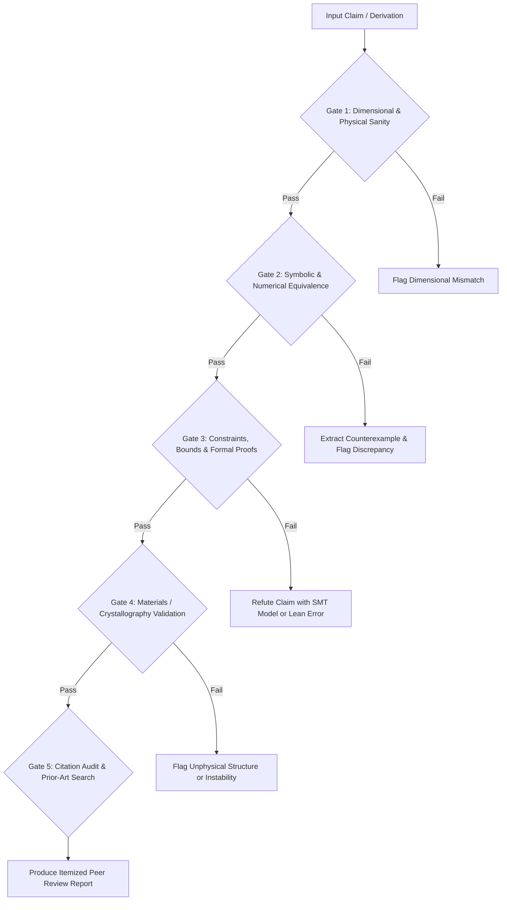

# Scientific Verification Protocol (Math, Physics & Materials Science)

This skill encodes the mental models, rigor standards, and verification checklists used by mathematicians, theoretical physicists, and materials scientists. When assisting researchers or auditing AI-generated scientific outputs, execute this systematic protocol using the `sci_verifier_mcp` tools.

---

## 1. Golden Rules of Scientific Verification

1. **Never Accept Simplification by Eye**:
   - Algebraic derivations frequently contain subtle sign errors, dropped factors of $2$ or $\pi$, or branch cut discrepancies.
   - Always call `check_equation_equivalence` with both symbolic simplification AND domain-valid randomized numerical sampling.
   - If equivalence fails, inspect the concrete numerical counterexample to identify where the sign or factor was lost.

2. **Dimensions & Units First**:
   - Before wasting time on multi-page algebra or numerical simulations, verify dimensional consistency using `check_dimensional_analysis`.
   - In natural units ($\hbar = c = 1$), ensure all terms scale to the same energy/mass dimension exponent $D = [M] - [L] - [T] + [\Theta]$.
   - In materials science, ensure proper conversion between $\text{eV/atom}$, $\text{kJ/mol}$, $\text{GPa}$, $\text{\AA}$, and $\text{S/cm}$.

3. **Check Boundary Conditions & Edge Cases**:
   - Test extreme limits: $n = 0, 1, \infty$; $T \to 0, T \to \infty$; $c \to \infty$ (non-relativistic limit); $\hbar \to 0$ (classical limit).
   - Verify inequality claims and domain restrictions using `check_smt_claim` with Z3.

4. **Zero Tolerance for Formal Proof Cheats**:
   - In formal proof systems (Lean 4), never accept proofs containing `sorry`, `admit`, or newly asserted `axiom` statements.
   - Run `verify_lean4_proof` in the sandboxed runner and report line-numbered compiler diagnostics.

5. **Physical & Crystallographic Sanity**:
   - Reject unphysical crystal structures: any atomic pair distance $< 0.7\text{ \AA}$ indicates unphysical nuclear overlap.
   - Cross-check claimed space groups against the symmetry computed by `validate_crystal_structure`.
   - Verify electroneutrality and plausible oxidation states with `check_stoichiometry_and_valence`.
   - Check energy above hull ($E_{\text{hull}}$) via `verify_material_properties`: materials with $E_{\text{hull}} > 0.1\text{ eV/atom}$ are typically metastable or experimentally unfeasible.
   - Search OPTIMADE with `check_novel_structure_prior_art` before claiming a crystal polymorph or composition is novel.

6. **Zero Tolerance for Hallucinated Citations**:
   - LLMs frequently fabricate DOIs, combine real author names with imagined titles, or misattribute discovery years.
   - Validate every citation using `verify_citation` or `audit_bibliography` against Crossref and arXiv registries.
   - Search prior art using `find_similar_papers` across Semantic Scholar, arXiv, and INSPIRE-HEP before claiming an equation or theorem is original.

---

## 2. Multi-Stage Verification Workflow

When presented with a derivation, paper draft, or material prediction, orchestrate the audit through these sequential gates:



### Stage 1: Dimensional Analysis
Call `check_dimensional_analysis`:
```json
{
  "equation": "E = m * c**2",
  "symbol_units": {"E": "joule", "m": "kg", "c": "m/s"},
  "unit_system": "SI"
}
```

### Stage 2: Step-by-Step Algebraic Verification
Call `check_equation_equivalence` for each derivation step:
```json
{
  "lhs": "\\sin^2(\\theta) + \\cos^2(\\theta)",
  "rhs": "1",
  "format": "latex"
}
```

### Stage 3: Inequalities & Formal Proofs
Call `check_smt_claim`:
```json
{
  "claim": {
    "op": "implies",
    "premise": {"op": ">", "left": "x", "right": 0},
    "conclusion": {"op": ">", "left": "x + 1", "right": 1}
  },
  "variables": {"x": "real"}
}
```
If Lean 4 code is present, call `verify_lean4_proof`.

### Stage 4: Materials Structure & Property Audit
- Call `validate_crystal_structure` on CIF/POSCAR text.
- Call `check_stoichiometry_and_valence` on formulas or chemical reaction equations.
- Call `verify_material_properties` with Materials Project ID or formula.
- Call `check_novel_structure_prior_art` to check open crystal databases.

### Stage 5: Citation & Prior-Art Audit
- Call `audit_bibliography` on the BibTeX block.
- Call `find_similar_papers` with domain=`"math"`, `"physics"`, `"hep"`, or `"materials"`.

---

## 3. Tool Reference Quick-Map

| Tool Name | Domain | Primary Purpose | Key Check |
|---|---|---|---|
| `check_equation_equivalence` | Math / Physics | Symbolic & numerical equivalence | Catches sign errors, factor drops, branch cuts |
| `check_dimensional_analysis` | Physics / Materials | Multi-term dimensional consistency | Validates SI & natural units ($\hbar=c=1$) |
| `check_smt_claim` | Logic / Math | Proves/refutes inequalities via Z3 | Provides counterexample models |
| `verify_lean4_proof` | Formal Proofs | Sandboxed Lean 4 compiler check | Rejects `sorry`/`admit`/unvetted axioms |
| `simplify_tensor_expr` | GR / QFT | Cadabra2 tensor algebra | Symmetries and contractions |
| `validate_crystal_structure` | Materials Science | CIF/POSCAR validation | Rejects distances $< 0.7\text{ \AA}$, validates spacegroup |
| `check_stoichiometry_and_valence`| Chemistry / Materials | Charge neutrality & reaction balance | Conserves elemental mass & charge |
| `verify_material_properties` | Materials Science | Materials Project computed reference | Band gap, $E_{\text{hull}}$, stability |
| `check_novel_structure_prior_art`| Materials Science | OPTIMADE federated crystal search | Verifies novelty across COD, MP, AFLOW |
| `verify_citation` | Literature | Single DOI/arXiv cross-check | Eliminates hallucinated papers |
| `audit_bibliography` | Literature | Concurrent BibTeX verification | Flags nonexistent/mismatched references |
| `find_similar_papers` | Literature | Cross-registry similarity search | Uncovers prior art across S2, arXiv, INSPIRE |
